# 8. User guide with screenshots

[← Data model and API](07-data-model-and-api.md) · [Contents](README.md) · [Next: Testing and results →](09-testing-and-results.md)

All screenshots were taken from the running system on 14 October 2026, with
the real Qwen2.5-1.5B-Instruct model and the 11 sample documents. The answers
shown are the system's real answers.

## 8.1 Logging in

Open `http://127.0.0.1:8000/` (main.py opens it automatically). Enter the
username and password given by the Super Admin. After login, each role goes
to its own start page.

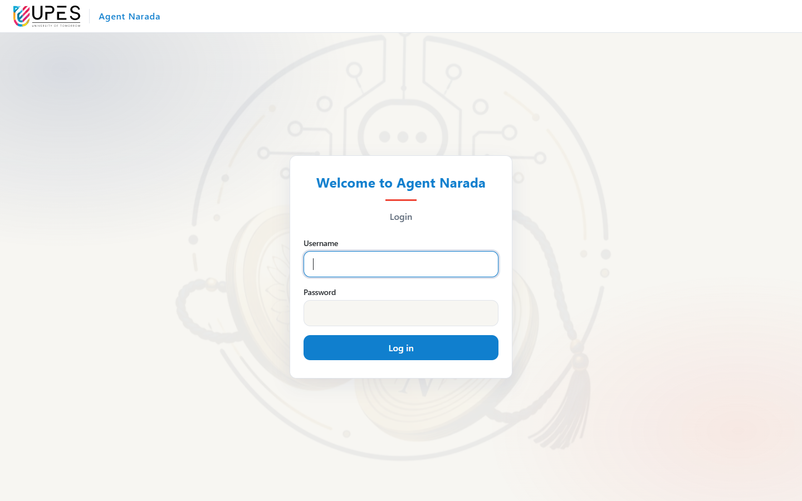

## 8.2 Students and staff: the chat page

The chat page has the conversation in the middle, the question box at the
bottom, and the user's own chats of the last 7 days on the left.

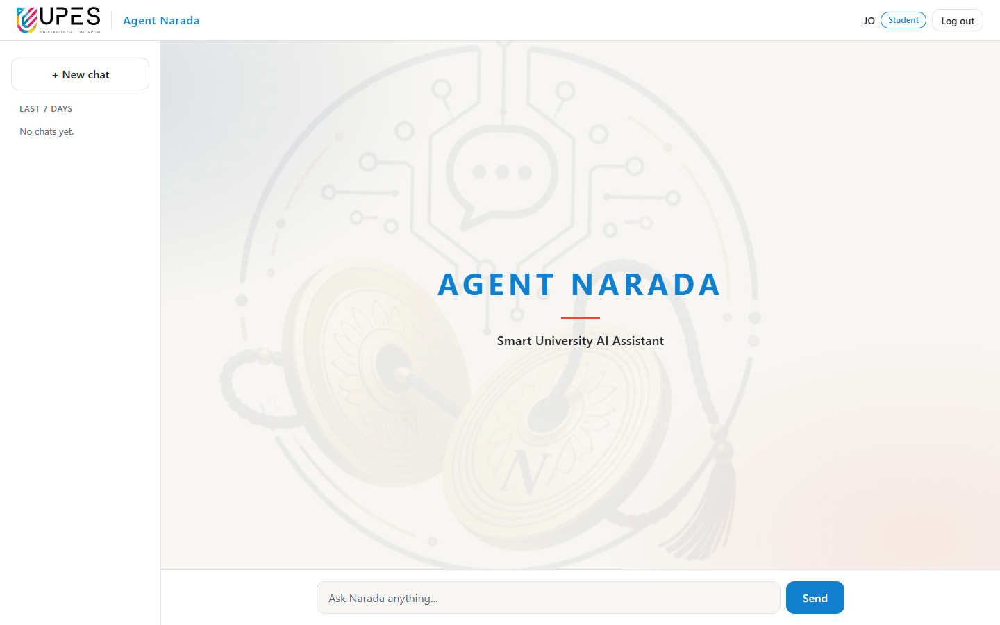

### Asking a question

Type a question and press **Send** (or Enter). The answer comes in about two
seconds, with its **sources** underneath: the document, its section, and for
PDFs the page.

### Spelling mistakes, short forms and Hinglish

Questions do not need to be well written. Spelling mistakes are corrected
from the documents' own words, and Hindi question words typed in English are
understood.

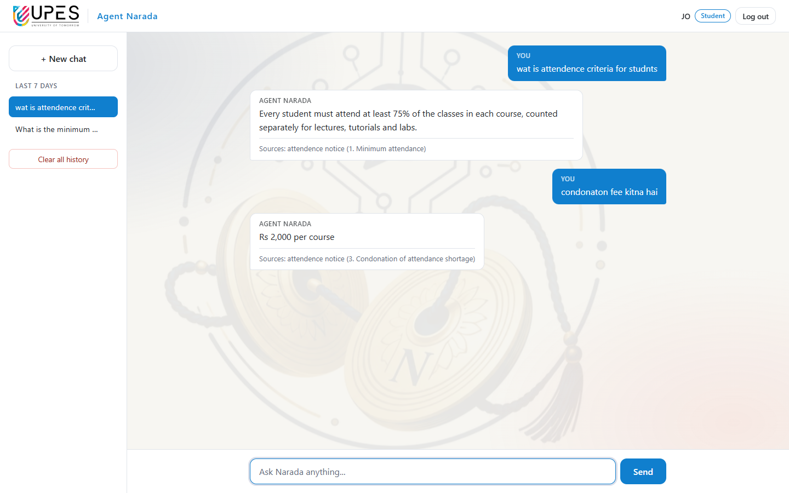

### Follow-up questions

A short follow-up in the same chat is understood from the previous question.

### Greetings and off-topic questions

Greetings get a friendly reply. Questions that have nothing to do with the
university are politely refused.

### When the documents do not have the answer

If the documents the user may read do not contain the answer, Agent Narada
says so instead of guessing. Here a **student** asks about a staff salary
(a document students may not read) and about the vice chancellor (not in any
document).

### Partly answered questions

If only part of a question is covered, that part is answered and the rest is
named.

### Sources from a PDF, with the page

### The same question, different roles

**Teaching staff** can read the salary policy, so the same salary question
gets an answer:

**Non-teaching staff** get answers from their own handbook (even with a
misspelled "unifrom"), but not from the exam date sheet, which is not open to
them:

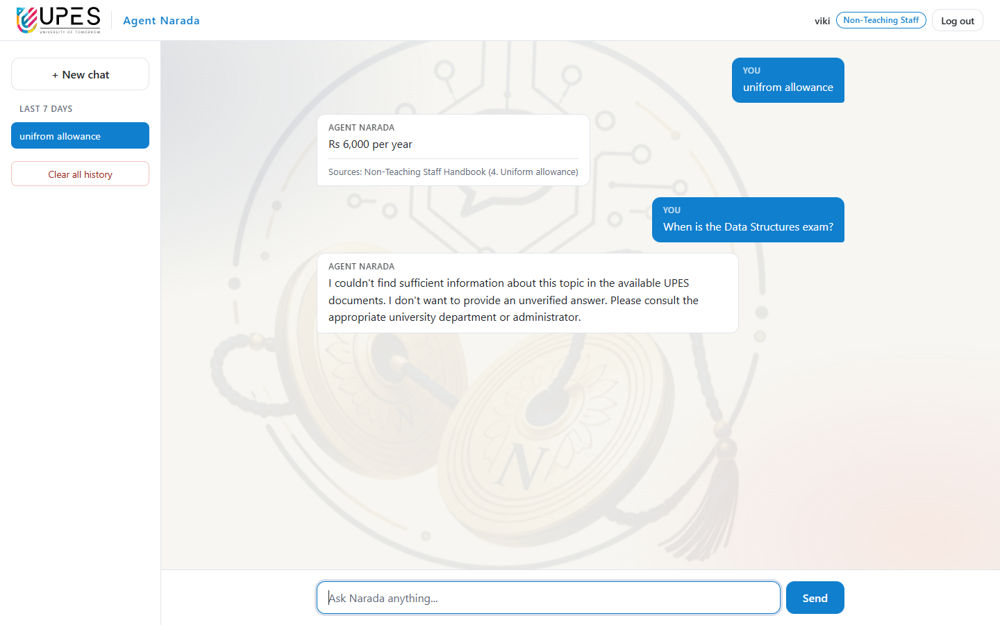

### Chat history

- **+ New chat** starts a new conversation.
- Click a chat on the left to open it and continue it.
- The **×** that appears on a chat deletes it (after "Are you sure?").
- **Clear all history** deletes all of your chats (after "Are you sure?").
- Chats older than 7 days are deleted automatically.

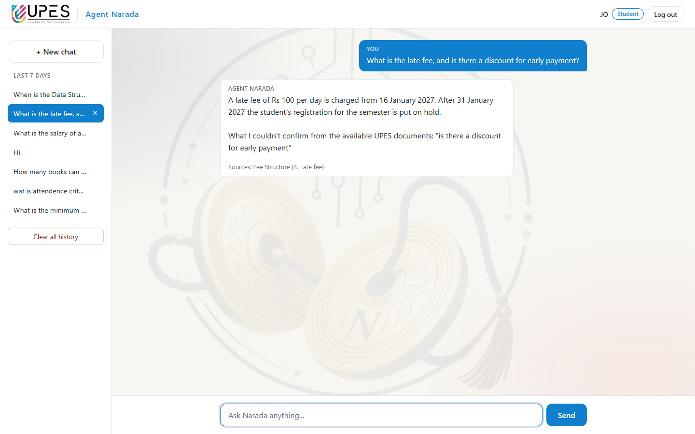

## 8.3 Super Admin

### Dashboard

Totals of users by role and documents by status.

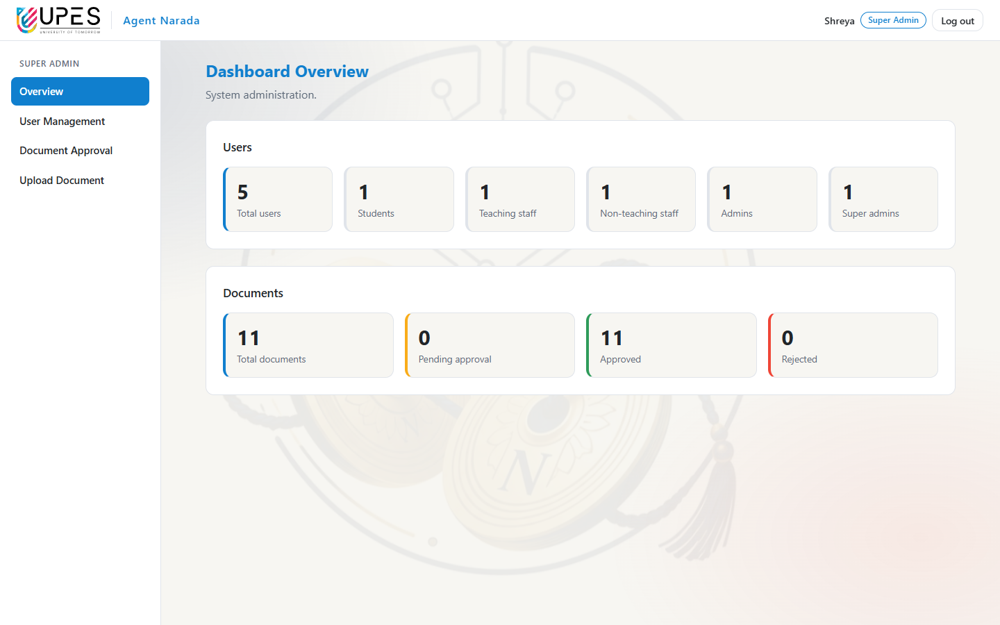

### User management

Add an account (choosing its role), modify it (name, email, role, password,
active or not) or delete it. The Super Admin's own row cannot be deleted.

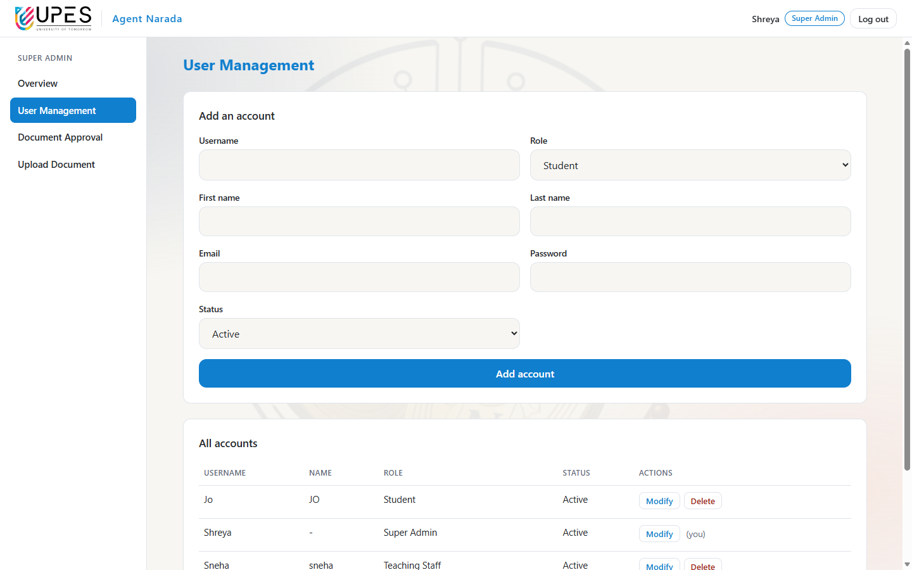

### Document approval

The page opens on **Pending**: uploads by Admins waiting for a decision.
**Approve** makes a document part of Agent Narada's knowledge for the ticked
groups; **Reject** asks for a reason, which the Admin sees.

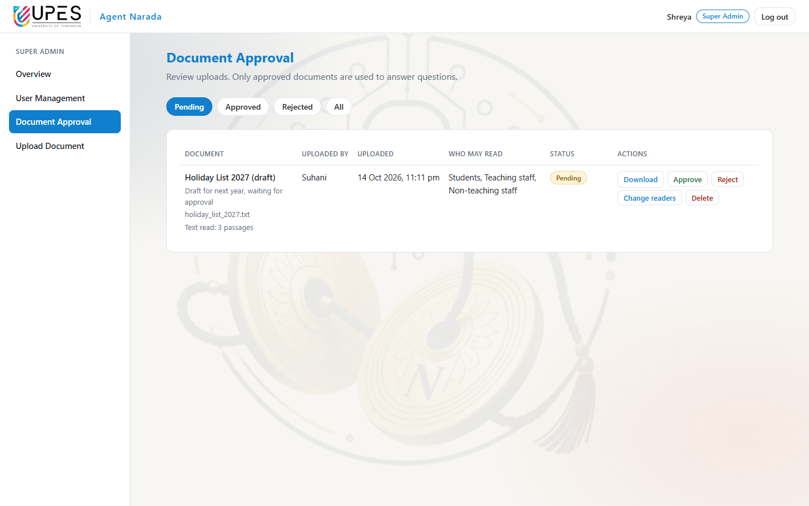

**Approved** lists the active knowledge base: each document's file, how many
passages its text became, who may read it, and who approved it.

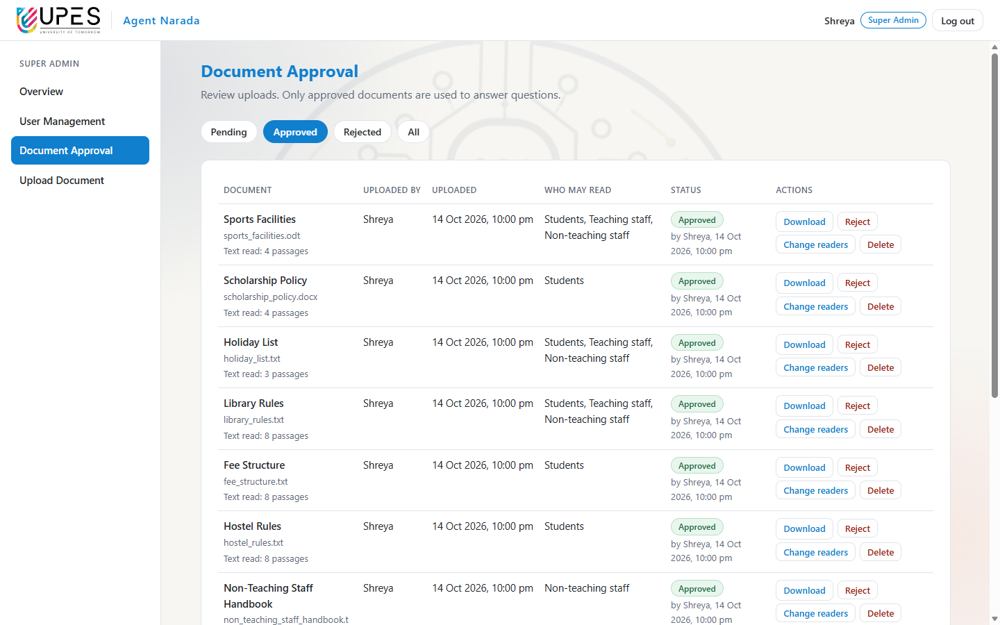

### Changing who may read a document

**Change readers** shows three tickboxes. Saving asks for confirmation
("Now: Students / New: Students, Teaching staff") and takes effect from the
next question; the document stays approved and is not uploaded again.

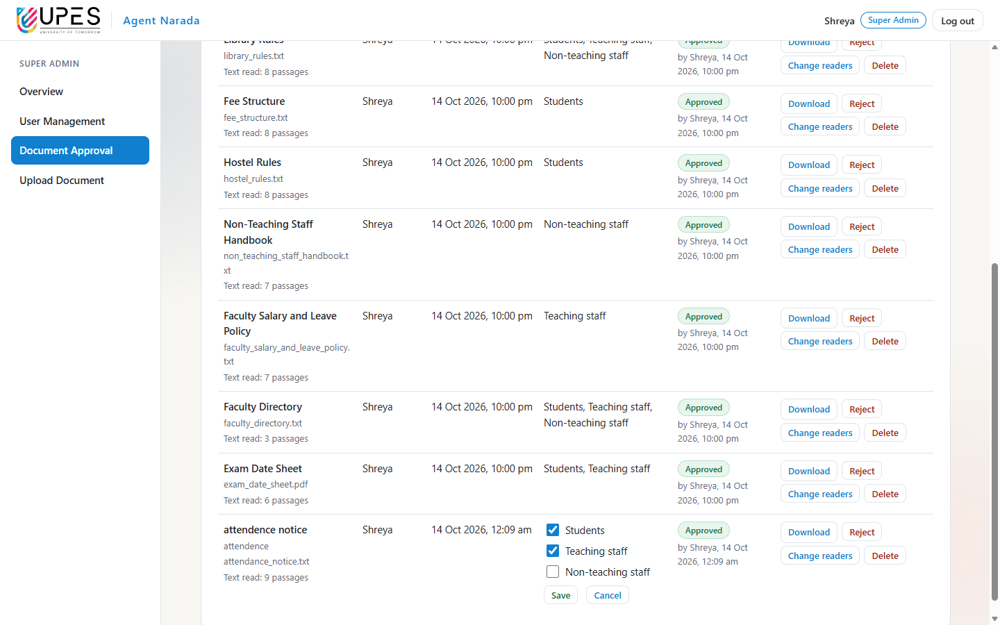

### Uploading a document

Fill in the title, an optional description, choose the file (PDF, DOCX, DOC,
ODT or TXT, up to 10 MB) and tick who may get answers from it. Before
uploading, the page asks for confirmation and lists who **will** and who
**will not** get answers from it. A Super Admin's upload is approved at once.

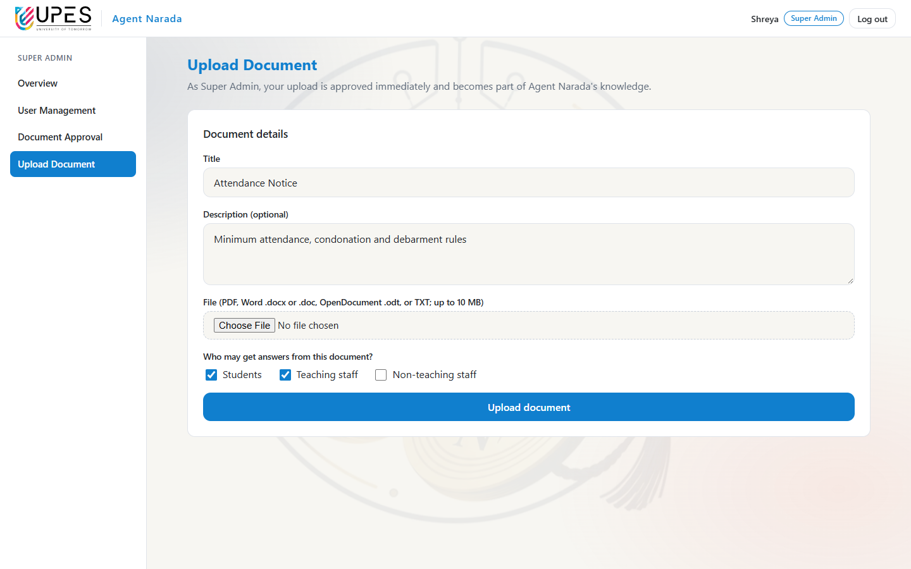

## 8.4 Admin

### Dashboard

The Admin's own uploads by status, and how approval works.

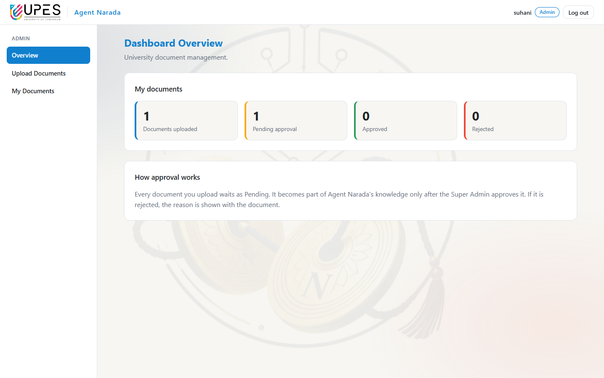

### Uploading

An Admin's upload is stored **and its text is read** straight away, but it
waits as **Pending** until the Super Admin approves it. Until then it is never
used for answers.

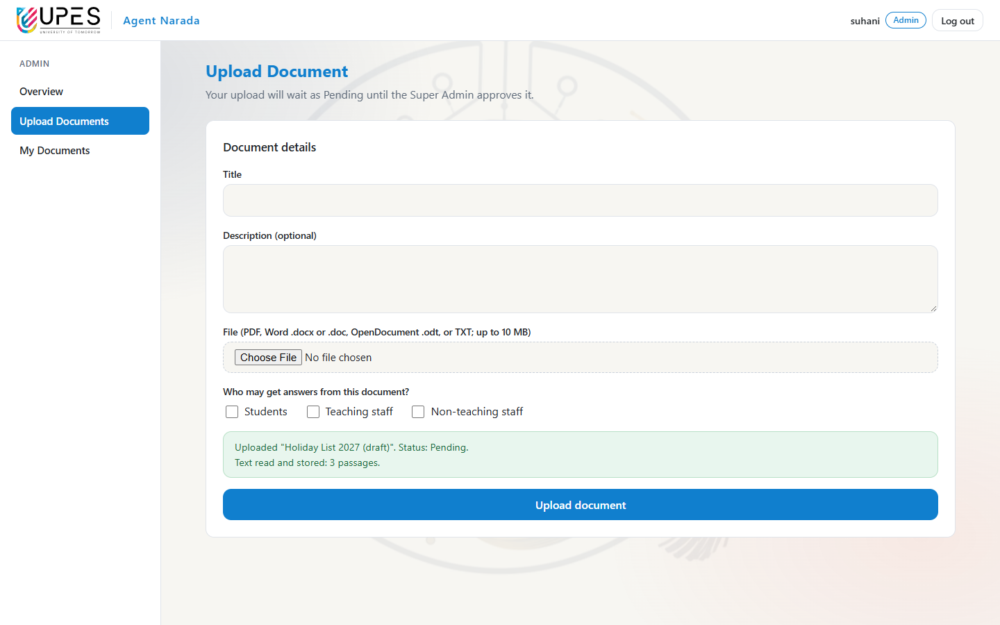

### My documents

The Admin's own uploads and their status. An Admin can delete or change the
readers of their own documents until they are approved.

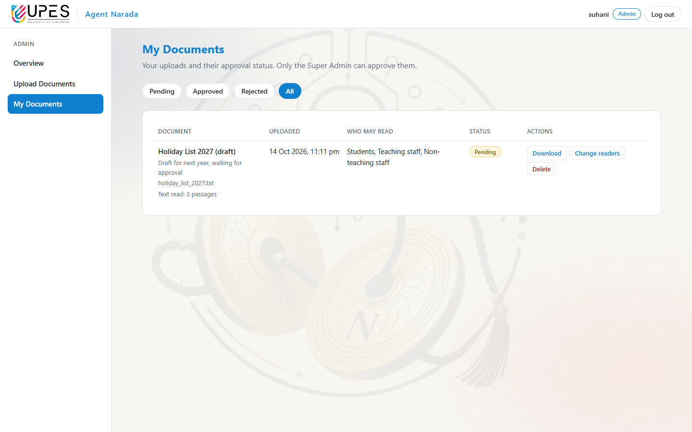
